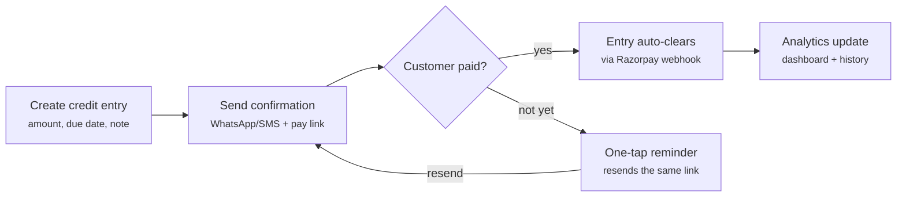

# Udhaar Suite — MVP Definition

Sep 29, 2026

## Summary

Udhaar Suite is a mobile module inside the Razorpay merchant app. It lets small merchants record credit (udhaar) in seconds, confirm it with the customer on WhatsApp/SMS, and collect it through a Razorpay payment link or QR. The entry clears itself when the customer pays.

**One-line pitch:** Give credit safely, get paid on time, skip the awkward follow-up.

## Problem

Most small merchants give informal credit to regular customers, but tracking and recovering it is manual and uncomfortable.

- **No reliable record:** credit lives in a paper khata or memory, so amounts and dates get disputed.
- **Awkward recovery:** asking a known customer for money repeatedly feels rude, so merchants delay or skip it.
- **Slow collection:** even a willing customer has no instant, easy way to pay back, so dues drift past the promised date.
- **Disconnected from payments:** repayments received online are not matched to the credit entry, so the merchant reconciles by hand.
- **No view of risk:** merchants cannot see who pays on time and who does not before extending more credit.

## Target users

The primary user is a small, repeat-customer merchant already on Razorpay (or onboarding to it) who runs the business from a phone.

| Persona | Example | Credit pattern | What they need most |
| --- | --- | --- | --- |
| Neighbourhood retailer | Kirana, pharmacy, dairy | Many small tabs, weekly or monthly settlement | Fast entry, bulk reminders |
| Local service provider | Tailor, repair shop, tutor | Fewer, larger dues tied to a job | Clear due date, confirmation proof |
| Small wholesaler / B2B seller | Distributor supplying shops | Larger invoices on 15–30 day terms | On-time payment tracking per buyer |

**Secondary user:** the customer who receives the credit. They need a clear message, the amount and due date, and one tap to pay. No app download.

## Solution and value proposition

Udhaar Suite turns a verbal promise into a confirmed, payable, self-clearing record. Razorpay sends the reminders and collects the money, so the merchant does not have to ask.

| For | Value |
| --- | --- |
| Merchant | Record credit in under 30 seconds; reminders sent without a personal ask; repayment matched automatically; see who pays on time before giving more credit |
| Customer | A clear written record of what they owe and when; pay in one tap by UPI, card or netbanking |
| Razorpay | More payment volume through links and QR; a daily-use reason to open the app; repayment data that can later support credit and lending products |

## MVP scope

The MVP covers five capabilities, from recording credit to seeing who repays well.

| # | Capability | What it does in the MVP |
| --- | --- | --- |
| 1 | Create credit entry | Pick or add a customer (name, phone), enter amount, due date and an optional note |
| 2 | Confirm with customer | Send a WhatsApp/SMS with amount, due date and a Razorpay payment link at creation |
| 3 | One-tap reminders | Automatic reminder 24 hours before the due date, plus one-tap reminders from the entry or the customer's page, each with the pay link |
| 4 | Collect and auto-clear | Customer pays by payment link or QR; the entry is marked paid (full or partial) via Razorpay webhook |
| 5 | Analytics and customer history | Dashboard: total credit given, credit due, credit paid. Per customer: on-time payment rate, average due amount, average days to pay, entry history |

**Out of scope for the MVP**

- Interest, late fees or penalties
- Automatic reminders on or after the due date (only the 24-hour-before reminder is automatic)
- Credit scoring, credit limits or merchant financing
- Customer acknowledgement of an entry (messages are one-way)
- Customer-facing app or login
- Web dashboard (mobile only)

## Core user flow

The merchant acts only twice: creating the entry and, if needed, tapping remind. Razorpay handles collection, matching and the analytics update.

## Razorpay ecosystem fit

Udhaar Suite is built on Razorpay products that already exist. The new pieces are the credit ledger and the analytics on top of it.

| Building block | Existing Razorpay capability | Role in Udhaar Suite |
| --- | --- | --- |
| Payment collection | Payment Links, UPI QR codes | One link or QR per credit entry |
| Messaging | Payment Link notifications (SMS/email); WhatsApp via partner | Confirmation and reminder messages |
| Auto-clear | Payment webhooks (payment.captured, payment_link.paid) | Match payment to entry and mark it paid |
| Money movement | Settlements to merchant account | Repayments settle like any other payment |
| Surface | Razorpay merchant mobile app | Udhaar Suite lives as a tab or module |

**New to build:** customer and credit-entry ledger, entry–payment matching logic, WhatsApp templates, and the analytics layer.

## Success metrics

The north-star metric is **credit value recovered through Razorpay per month**. It captures both merchant adoption and collection success. Targets below are placeholders to set during the pilot.

| Area | Metric | Pilot target |
| --- | --- | --- |
| Adoption | Merchants who create at least 1 credit entry in their first 7 days | TBD |
| Engagement | Credit entries created per active merchant per week | TBD |
| Collection | Share of credit value repaid online by due date | TBD |
| Collection | Median days from entry to repayment | TBD |
| Reminders | Share of reminders followed by a payment within 48 hours | TBD |
| Retention | Merchants active in month 2 after first use | TBD |

## Risks and open questions

**Key risks**

- **Cash repayments:** many customers repay in cash, which bypasses auto-clear and weakens the analytics.
- **Relationship sensitivity:** reminders that feel pushy could hurt the merchant–customer relationship.
- **WhatsApp cost and approval:** business messaging needs approved templates and has a per-message cost.
- **Regulation:** the product must stay a ledger and collection tool. Charging interest or taking credit risk would bring RBI lending rules into play.
- **Competition:** free khata apps already cover record-keeping; the edge has to be collection plus auto-clear.

**Decisions taken on the open questions**

| Question | Decision |
| --- | --- |
| Customer acknowledgement of an entry | Not in the MVP; the message is one-way |
| Partial payments and multiple entries | Every payment clears the oldest open entry first, then the next |
| WhatsApp message cost | Covered by a free quota |
| Pricing for merchants | Free |
| Reminder schedule | Automatic reminder 24 hours before the due date, plus manual one-tap reminders |
| Languages | English and Hindi, switched with one tap from a clearly visible toggle in the top header |
